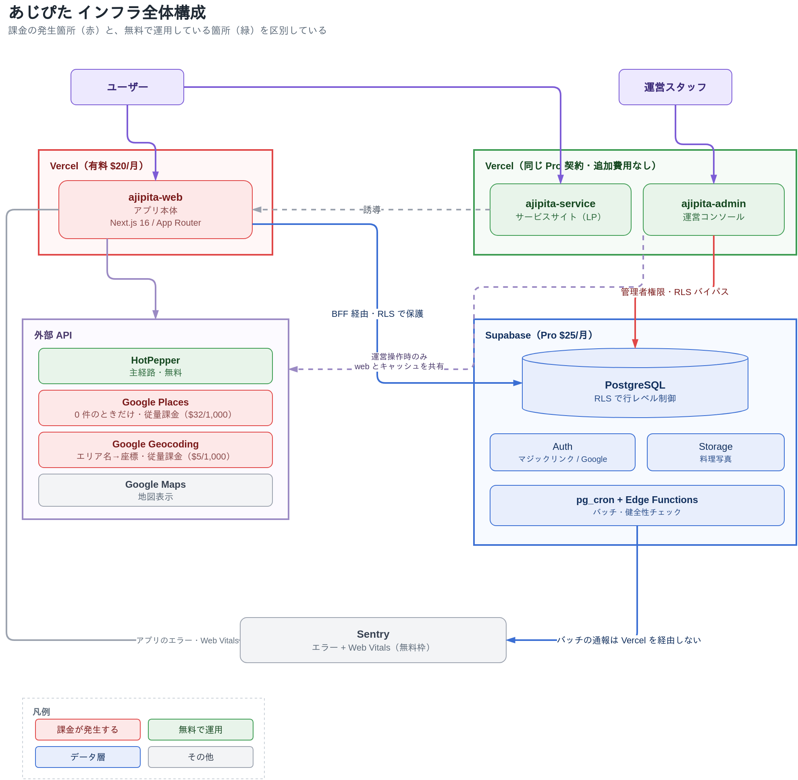

# 1. 全体構成

← [トップに戻る](../README.md)

---

## 1.1 7 つのリポジトリ

あじぴたは 7 つのリポジトリで構成されています。



> 図は [`diagrams/infrastructure.drawio`](./diagrams/infrastructure.drawio) で編集できます。

| リポジトリ | 役割 | 公開範囲 |
| --- | --- | --- |
| **ajipita-web** | アプリ本体。ユーザーが使う画面のすべて | 一般公開 |
| **ajipita-admin** | 運営コンソール。通報対応・店舗申請・お知らせ配信 | 運営のみ |
| **ajipita-service** | サービスサイト（LP）。アプリへの誘導が役割 | 一般公開 |
| **ajipita-extensions** | 運用作業を効率化するために自作した Chrome 拡張 | 自分のみ |
| **ajipita-growth** | 運用・グロース・資金調達の管理。**コードは置かない** | 自分のみ |
| **ajipita-articles** | 技術記事の執筆管理。**コードは置かない** | 自分のみ |
| **ajipita**（親） | 上の 6 つを 1 か所から動かす指揮役。共通のスキルと安全装置を各リポジトリへ配る。**コードは置かない** | 自分のみ |

サービスサイトをアプリ本体と分けたのは、**役割が違うから**です。LP はブランド体験と誘導が仕事で、
静的中心・DB 不要。アプリ本体の認証やデータアクセスの制約を持ち込む必要がありません。
デザイントークンだけは共有して、ビジュアルの一貫性を保っています。

運用していると、手作業で繰り返すタスクが出てきます。そういうものは**その都度ツールを作って潰す**
方針で、Chrome 拡張もその 1 つです。

### コードを置かないリポジトリ

`ajipita-growth` と `ajipita-articles` は性質が違います。**コードが 1 行もありません**。
施策・数字・資金調達の検討と、技術記事の執筆を置く場所です。

リポジトリにした理由は、施策の検討や記事の下書きを**ファイルで管理したかった**からです。
コードと同じく、**Claude Code にそのまま作業してもらえる形**にしています。

施策の管理で効いているのが、**主指標の置き方**です。

> 累計ユーザー数ではなく、**「1 人あたりのレビュー数 / 投稿者率」**を主指標にしています。

マッチングの精度は**評価データの密度**で決まるので、
登録者だけが増えても推薦は良くなりません。
「とりあえず登録を増やす」施策は、指標の上では成功しても**プロダクトとしては前に進んでいない**わけです。

もう 1 つ、**サービスの思想に反する施策は採らない**という制約を先に書いてあります。

例えば「辛口レビュー募集」のような企画は、話題になる可能性はあります。
でもあじぴたは**低評価を公開しない**設計なので（→ [2 章](./02-product-design.md)）、
この時点で却下されます。**判断のたびに迷わないよう、制約のほうを先に固定しておく**という考え方です。

施策の書式にも、**コスト（金銭 + 自分の工数）と撤退ラインを必ず書く**という縛りを入れています。
1 人で運用している以上、**回らない施策は立てない**ことのほうが重要でした。

`ajipita-articles` のほうは、技術記事の下書きと構成を置いています。

記事を書く作業は、**自分の理解を強くする**ことに直結しています。

実装をしている最中は、判断しなければならないことがたくさんあります。
そしてその多くは、時間が経つと忘れてしまう。
せっかく考えた判断を無駄にしないために、**記録として残しておく**のが出発点です。

さらに、それを「なぜこの構成なのか」と**他人に説明できる形へ昇華させる**ことで、
判断の理由が自分の中でも整理され、**使える知識として身につきます**。

その積み重ねで知見が広がり、**エンジニアとして強くなれる**。
次に似た判断をするときの速さも、その結果としてついてくるものだと考えています。

**このドキュメント自体も、記事を書こうとしたことがきっかけで生まれました。**

なお、ここに置いてあるのは**記事の材料であって、記事そのものではありません**。
公開先は Qiita と Zenn で、そちらはさらに別のリポジトリで管理しています。

### ホスティングは 2 社に分けていたが、Vercel に集約した

| リポジトリ | 〜2026-10 | 2026-11〜 |
| --- | --- | --- |
| ajipita-web（アプリ本体） | **Vercel** | **Vercel** |
| ajipita-admin（運営コンソール） | Netlify | **Vercel** |
| ajipita-service（LP） | Netlify | **Vercel** |

まず、当初 2 社に分けていた理由です。理由は 2 つありました。

**1. Vercel の無料プランは商用利用ができない**

Vercel の Hobby プランは**非商用・個人利用に限られます**。
あじぴたは商用サービスなので、無料プランのまま運用することはできません。

有料プランは**プロジェクト単位ではなくアカウント単位**の契約です。
とはいえ、3 つすべてを Vercel に載せる必要はありませんでした。

**2. メインアプリの枠を圧迫したくない**

ビルド時間や帯域といったリソースは、アカウント全体で共有されます。
管理画面や LP のビルドが、**ユーザーが実際に触るアプリ本体のリソースを削る**構図は避けたい。

Netlify には商用利用が可能な無料枠があるため、
**アプリ本体以外を Netlify に逃がす**構成にしました。

結果として、Vercel のリソースはアプリ本体に集中し、
admin と service は追加コストゼロで運用できています。

> **副次的な効果**: ホスティングが分かれたことで、
> **片方の障害がもう片方に波及しません**。
> Vercel が落ちても LP は生きているので、サービスの告知ができます。

#### 集約した理由（2026-11）

前提が 2 つとも変わりました。

- **アプリ本体のために Vercel Pro を契約した。** 契約はアカウント単位なので、admin と service を載せても追加の契約は要りません。admin の利用者は運営だけで、アプリ本体の枠もほとんど使いません
- **応答の速さが効いてきた。** Netlify の関数は既定で米国で動きます。Vercel では関数を東京リージョンで動かせるので、
  東京の DB に近い場所で処理できます
- **LP の表示の速さは、登録の手前の離脱に直結する。** LP は広告やキャンペーンから最初に着く場所です。
  ここで待たせると、アプリにたどり着く前に帰られてしまいます

効果は運営コンソールで特にはっきり出ました。

| | Netlify（米国） | Vercel（東京） |
| --- | --- | --- |
| 最初の応答までの時間（実測） | 0.27〜0.53 秒 | **0.06〜0.19 秒** |
| 画面の操作（体感） | 大抵の操作で数秒待つ（3 秒以上のことも） | **1 秒も待たない** |

1 回の応答の差は 0.3 秒ほどでも、1 つの操作で DB を何度も引くと、その分だけ積み重なります。
毎日触る道具が「もっさり」から「快適」に変わったのが、いちばん大きな変化でした。

障害を分ける効果は失いましたが、**日々の運用の速さと、利用者の入口の速さ、管理する場所が 1 つになることを優先**しました。

### admin は本番だけを公開する

admin は管理者権限でデータベースを触るため、**公開面を本番だけに絞っています**。

プレビューデプロイとブランチデプロイは**無効化**しました。
これらは**認証のない公開 URL を自動生成する**ためです。

さらに、**当時の Netlify の無料枠にはサイト全体のパスワード保護機能がありませんでした**
（上位プランの機能です。Vercel でも Pro に追加料金がかかる機能なので、移行後も同じ）。
そのため、同等のゲートを自前で用意し、その内側に運営セッションの認証を置いています。

**ホスティングの制約が、認証の設計をひとつ増やした**形です。
認証を階層にした理由は [1.2](#12-同じ-db-を-2-つの流儀で触る) で書きます。

---

## 1.2 同じ DB を 2 つの流儀で触る

この構成で一番特徴的なのは、**web と admin が同じデータベースに対してまったく違うアクセスの仕方をする**点です。

| | ajipita-web | ajipita-admin |
| --- | --- | --- |
| データアクセス | BFF（API 層）に一本化 | 管理者権限のクライアントで直接 |
| 権限制御 | **RLS（Row Level Security）** | RLS をバイパス |
| 認証 | Supabase Auth（マジックリンク + Google） | 独立したテーブル + 自前の署名 Cookie |
| ユーザー体系 | サービスのユーザー | 運営スタッフ（サービスユーザーとは完全に別） |
| マイグレーション管理 | **こちらが正** | 持たない（web を参照） |
| 外部 API の上限 | 経路ごとに上限を掛ける | 掛けない（認証の内側のため） |

### なぜ流儀を変えたのか

**web は「信頼できないクライアント」が相手**です。ブラウザから来るリクエストは疑ってかかる必要があり、
DB 側で行レベルの権限を強制する RLS が防衛線になります。アプリのコードにバグがあっても、
DB が最後に止めてくれる状態を作りたい。

**admin は「信頼された運営面」が相手**です。運営スタッフは全データを見る必要があります
（通報された口コミの確認、ユーザーの状態調査など）。ここに RLS を敷くと、
「全部見えるようにするためのポリシー」を書くことになり、**RLS を使う意味がなくなります**。
それなら最初からバイパスして、代わりに**アクセスできる人間を絞る**方が素直です。

だから admin の認証はサービス側と完全に分離しています。サービスのユーザーがどれだけ増えても、
admin に入れる人間は増えません。

### RLS を外した分、入口を厚くする

RLS という防衛線を外した以上、**そこに入れる人間を絞る側で担保する**必要があります。
admin は認証を 2 段構えにしました。

1. **サイト全体の簡易ゲート** … 偶発的な到達を防ぐ。静的アセットには掛からない
   （[1.1](#admin-は本番だけを公開する) に書いたとおり、
   ホスティング側にこの機能が無いため自前で用意したものです）
2. **運営セッション** … 管理画面と管理用 API を保護する本命の認証

さらに、各処理の入口でも**個別にセッションを検証**しています。
入口のガードをすり抜けても、処理側で止まる構造です。

「1 箇所で守る」のではなく「**何重にも守る**」方針にしたのは、
admin が突破されたときの被害が全データに及ぶためです。

### マイグレーションを web に集約した理由

同じ DB を触る 2 つのリポジトリが、それぞれマイグレーションを持つと**適用順序が破綻します**。
どちらが先に走るかで DB の状態が変わってしまう。

そこで、**スキーマ変更は web リポジトリだけが持つ**と決めました。admin が必要とするテーブル
（運営スタッフのアカウントなど）も、web 側のマイグレーションとして管理します。
admin は既にあるスキーマを前提に動くだけです。

---

## 1.3 規約をどう共有するか

コードのある 4 つのリポジトリで、命名規則・ディレクトリ構成・デザイントークンを揃えたい。
でもリポジトリは分かれている。

採った方法は、**web を正として、他リポジトリが同期スクリプトで取り込む**形です。

```
ajipita-web/docs/development/rules.md          ← 正本
        │
        │  sync-web-rules.sh
        ▼
ajipita-admin/docs/vendor/rules.md             ← コピー（手編集しない）
ajipita-service/docs/vendor/rules.md           ← コピー（手編集しない）
```

`vendor/` という名前にしているのは、**外から持ち込んだもので、ここでは編集しない**という
意思表示です。変更したければ web 側を直して、同期し直す。

### ドリフトは前提として受け入れる

この方式は完璧ではありません。web を更新しても、同期スクリプトを流すまで他リポジトリは古いままです。
つまり**ズレ（ドリフト）が必ず発生する**。

それでも採ったのは、代替案がもっと重いからです。

| 案 | 問題 |
| --- | --- |
| モノレポにする | 4 つのデプロイ先・デプロイ頻度が違う。CI が複雑になる |
| npm パッケージとして共有 | 規約ドキュメントのためにパッケージ公開とバージョン管理をするのは重い |
| Git submodule | 扱いが面倒で、更新忘れはどのみち起きる |
| **同期スクリプト** | ドリフトするが、仕組みが単純で壊れにくい |

ドリフトが実害になるのは「web で規約を変えたのに admin が古い規約で実装される」ケースですが、
これは**同期を流せば直る**し、流し忘れても既存コードが壊れるわけではありません。
リスクの大きさと仕組みの複雑さを天秤にかけて、単純な方を選びました。

---

## 1.4 この構成の良かった点・つらい点

### 良かった点

- **admin の存在が web を単純にした。** 運営機能を web に同居させると、
  「一般ユーザーには見せない画面」を RLS と UI の両方で守ることになります。
  リポジトリごと分けたことで、web は一般ユーザーのことだけ考えればよくなりました
- **LP を分けたので、アプリの都合に縛られない。** LP は静的中心で高速。
  アプリ側の認証やデータ取得の制約が一切かかりません
- **マイグレーションの集約は正解だった。** 同期の問題が構造的に起きません

### つらい点

- **横断的な変更が 2 〜 3 リポジトリに散る。** しかも**片方だけ直すと静かに壊れる**関係があります（下記）
- **同期スクリプトを流し忘れる。** 人間の運用に依存している部分です
- **admin のスキーマを web で管理するのは、最初は違和感がある。** 慣れると合理的ですが、
  「admin のテーブルなのに admin リポジトリに無い」状態は説明が要ります

### 実例: 片方だけ直すと静かに壊れる関係

アプリと LP で **Cookie 同意を共有**しています。LP で同意したらアプリでは聞かない、という挙動です。
実現のため、親ドメインの Cookie に同意状態を載せ、**両リポジトリで同じキーと形式**を読み書きします。

つまり、**片方のリポジトリだけを変更すると壊れる**関係です。

アプリ側の Cookie の読み取り方を見直したとき、**LP 側が古い読み取り方のまま**だと分かりました。
LP 側はキーを正規表現にそのまま埋め込んでいるため、キーに `.` などの文字が入ると、
**LP 側だけ Cookie を読み取れなくなります**。

今のキーにはそうした文字が含まれないので、**実害は出ていません**。
ただ、将来キーを変えたときに壊れる差です。

厄介なのは、**壊れたときの壊れ方**です。

```
例外は出ない
  → エラーも記録されない
  → 同意していないものとして扱われ、計測が静かに減るだけ
```

**気づく手がかりが無い。** テストも通ります。両リポジトリを並べて読まないと分かりません。
そこで、**キーを変えるときは LP 側の読み取りもそろえる**ことを仕様書に明記しました。

同じ「失敗しても例外が出ない」性質で、**アプリ側では実際に不具合が起きました**。
ブラウザが Cookie を拒否していると、書き込みは何も起きず、例外も出ません。
その結果、Cookie を拒否している環境では、**ユーザーが同意を取り消しても、次の訪問で元に戻っていました**。

Cookie を正としつつ、**書き込めなかったときは別の保存先（localStorage）に残す**ように直し、
修正前の実装で失敗する回帰テストも追加しています。

> **教訓**: リポジトリをまたぐ約束や、ブラウザの保存処理は、**壊れたときにエラーが出ない**ことがあります。
> 分割の代償や静かな失敗はここに出る、という前提で設計する必要があります。

---

## 1.5 まとめ

- 7 リポジトリ構成。**役割が違うものは分ける**方針。3 つはコードを置かない
- ホスティングは当初コストで 2 社に分け、前提が変わったので Vercel（東京リージョン）に集約した
- 同じ DB でも、**信頼できるクライアントかどうか**でアクセスの流儀を変えている
- スキーマの正本は 1 箇所に集約する
- 規約の共有はドリフトを受け入れて、**仕組みの単純さ**を取った

次章では、この構成を決めることになった**プロダクト側の設計**を見ていきます。
実は「料理単位で評価する」という 1 つの仕様が、DB の選定まで一直線に決めていました。

→ [2. プロダクト設計](./02-product-design.md)
